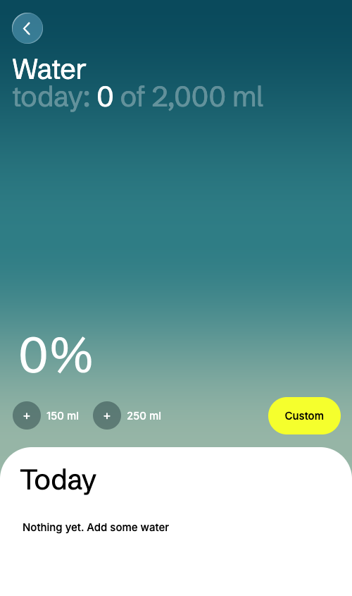

# Water

A water tracking app concept where the fill level is a real fluid sim reacting to your gyroscope.

Built with a WebGL fragment shader, damped pendulum physics, refraction and chromatic aberration. Zero dependencies, one HTML file.

[Original post on X](https://x.com/eugene_mindset)

## Try it

Open `index.html` in a browser — the water follows your cursor.

For the real thing, open the page on a phone over **HTTPS** (the gyroscope API requires it) — for example via GitHub Pages — add water and tilt the phone.

## How it works

- **One fullscreen fragment shader** draws everything: the water body, the surface, refraction, dispersion, volumetric light.
- **The surface is a damped pendulum**: tilt from the gyroscope drives a straight water plane that lags, overshoots, swings and settles, with subtle wobble and tremor added so it feels hand-held, not robotic. A separate spring layer handles tap ripples. Physics run at a fixed 60 Hz timestep so 120 Hz displays don't double the simulation speed.
- **The % number sits under the water** and is refracted like Apple's liquid glass: a convex squircle bezel profile (after [kube.io](https://kube.io/blog/liquid-glass-css-svg/)) sets the lens shape, and chromatic dispersion is done by multi-sampling along the refraction direction with per-channel smear lengths (after [Maxime Heckel](https://blog.maximeheckel.com/)).
- The number is rendered on a 2D canvas and passed to the shader as a texture.

## Notes

The original design uses ABC Solar and ABC Diatype by Dinamo — their licenses don't allow redistribution, so this version ships with open-source stand-ins: [Schibsted Grotesk](https://fonts.google.com/specimen/Schibsted+Grotesk) for display and [Inter](https://fonts.google.com/specimen/Inter) for text (both under the SIL Open Font License, included in `fonts/`).

## License

MIT
