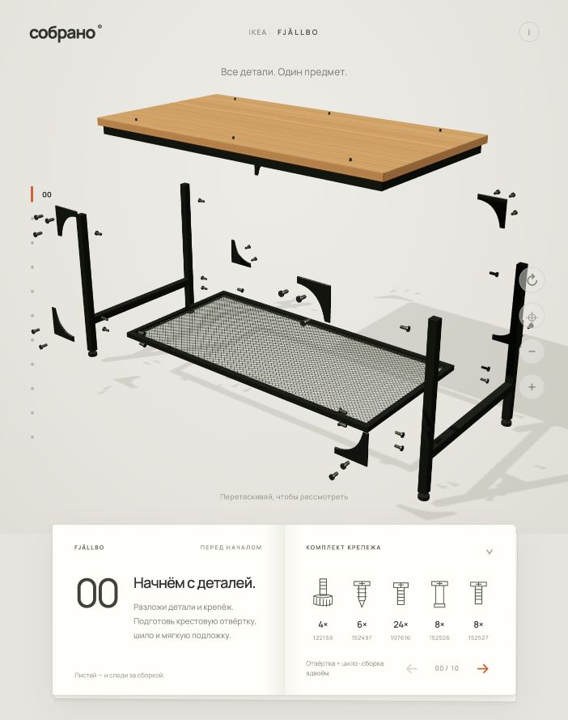

# Собрано — FJÄLLBO

Интерактивный прототип инструкции сборки IKEA FJÄLLBO: 3D-сцена, белая книжка шагов, анимации крепежа и автоматические крупные планы соединений.

**[Открыть опубликованный прототип](https://sobrano-lack-studio.ready-sky-2683.chatgpt.site)**



## Локальный запуск

Нужен Python 3. Установка зависимостей и сборка не требуются.

```sh
python3 -m http.server 4173 --directory dist
```

Откройте http://localhost:4173. Используйте HTTP-сервер: открытие `index.html` через `file://` не подходит для ES-модулей.

## Состав проекта

- `dist/index.html` — интерфейс сцены и книжки.
- `dist/style.css` — оформление и адаптивная вёрстка.
- `dist/app.js` — 10 этапов, анимации, камера и управление.
- `dist/model.js` — процедурная геометрия стола, крепежа и инструмента.
- `dist/three.module.js` — локальная копия Three.js r170.

## Управление

Стрелки на книжке переключают страницы. Точки слева позволяют перейти к любому этапу. Перетаскивание вращает сцену; колесо и кнопки +/− меняют масштаб. Кнопка ↻ повторяет движение текущего шага. Книжку можно свернуть.

## Развёртывание

Папку `dist/` можно разместить на любом статическом хостинге. Серверная часть, API-ключи и переменные окружения не нужны. Шрифт Manrope загружается из Google Fonts; при недоступности используется системный шрифт.

## Источник и ограничения

Сценарий основан на [официальной инструкции IKEA AA-1881476-2](https://www.ikea.com/us/en/assembly_instructions/fjaellbo-coffee-table-black__AA-1881476-2-100.pdf). Это неофициальный учебный прототип. Геометрия и движения упрощены; при реальной сборке следует пользоваться оригинальной инструкцией. 3D-модель построена программно, это не CAD-модель IKEA.

Лицензия сторонней библиотеки приведена в `THIRD_PARTY_NOTICES.md`.
